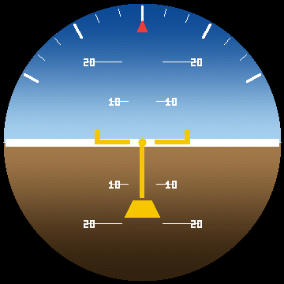

# ESP32 姿态仪（人工地平仪）

跑在 [微雪 ESP32-S3-Touch-LCD-1.85](https://www.waveshare.net/shop/ESP32-S3-Touch-LCD-1.85.htm)
圆形 360×360 屏幕上的**飞行仪表风格姿态仪（人工地平仪）**。



*上图是从设备**真实帧缓冲**直接导出的画面（360×360，RGB565），与屏幕显示逐像素一致。*

---

## 功能一览

| 功能 | 说明 |
| --- | --- |
| **人工地平仪** | 蓝天/棕地渐变 + 白色地平线 + 俯仰刻度梯（±10/20/30°，带数字）+ ±60° 滚转刻度弧与滑动红色指针 + 固定黄色飞机符号 |
| **一键对准** | **短按 BOOT** 把当前姿态记为"水平"并存进 NVS；**每次开机也会自动归零一次** |
| **开机动画** | 显示内置 Logo，0.8 秒交叉渐隐进入仪表画面 |
| **触摸调光** | 上/下拖动屏幕调亮度，每档 10%，底部黄色亮度条提示；**不自动降亮度、不自动熄屏** |
| **电池监测** | ADC 采样，串口可查看电压与百分比 |
| **WiFi OTA** | ArduinoOTA，带密码保护 |
| **崩溃保护** | 连续异常复位 2 次自动进入安全模式（只跑串口 + WiFi），防止变砖 |

画面计算基于**重力向量的投影模型**，不是欧拉角，因此**没有万向节锁** ——
设备竖立、倾斜 90° 甚至倒置附近都能正常显示。

---

## 硬件

- **开发板**：微雪 ESP32-S3-Touch-LCD-1.85（ESP32-S3R8，16 MB Flash，8 MB OPI PSRAM）
- **屏幕**：ST77916，360×360，QSPI 80 MHz（可视区为内切圆）
- **触摸**：CST816（I²C 地址 0x15）
- **姿态传感器**：QMI8658（I²C 地址 0x6B）
- **IO 扩展**：TCA9554PWR；**RTC**：PCF85063
- **供电**：锂电池 + USB-C，PWR 键长按关机

---

## 快速上手（直接刷预编译固件）

1. 从 **[Releases 页面](https://github.com/Hanice404/ESP32-AttitudeIndicator/releases/latest)** 下载 `attitude-indicator-merged.bin`（1.27 MB），也可以直接用本仓库 `firmware/` 里的同名文件。
2. 用 **偏移 0x0** 一次写入（四种烧录方式见 [烧录说明](FLASHING.md)）。
3. 把设备摆成你认为"水平"的姿态，**短按一次 BOOT**（或直接断电重启，固件会自动归零）。

```bash
pip install esptool
esptool.py --chip esp32s3 -p COM6 -b 921600 write_flash 0x0 attitude-indicator-merged.bin
```

---

## 操作说明

| 操作 | 效果 |
| --- | --- |
| **短按 BOOT**（40 ms ~ 1 s） | 对准地平线：把当前姿态记为水平基准 |
| **长按 BOOT**（约 2 s） | 屏幕方向 0° ↔ 180° 切换 |
| **上下拖动屏幕** | 加亮 / 减亮，每档 10%（5%~100%），底部黄色亮度条提示 |
| **双击屏幕** | 复位峰值记录 |
| **长按 PWR** | 关机 |
| 串口命令 `info` / `show` / `cal` / `save` / `reboot` … | 调试与调参（详见 `src/README.md`） |

---

## 从源码编译

需要 **arduino-cli**（或 Arduino IDE 2）、**ESP32 核心 3.1.1**、**LVGL 8.3.10**。

```bash
arduino-cli compile \
  --fqbn esp32:esp32:waveshare_esp32_s3_touch_lcd_185:PartitionScheme=app3M_fat9M_16MB,CDCOnBoot=cdc,USBMode=hwcdc,UploadSpeed=921600,DebugLevel=error \
  --libraries ./libs \
  src/AttitudeBall
```

完整的开发笔记（IMU 轴向映射、NVS 结构、**31 条踩坑记录**、全部串口命令）见 [`src/README.md`](src/README.md)。

---

## 自定义

| 想改什么 | 改哪里 |
| --- | --- |
| 开机 Logo | `src/tools/make-logo.ps1 我的Logo.svg`（SVG / PNG / JPG → `Boot_Logo.h`） |
| Logo 停留与渐隐时长 | `src/AttitudeBall/Config.h` → `SPLASH_HOLD_MS`、`SPLASH_FADE_MS` |
| 亮度上下限与步进 | `Config.h` → `BRIGHT_MIN` / `BRIGHT_MAX` / `BRIGHT_STEP` |
| 天地配色 | `src/AttitudeBall/UI_Horizon.cpp` → `skyR0…`、`gndR0…` |
| 地平线粗细、刻度梯间距 | `UI_Horizon.cpp`（`FOCAL`、`LADDER_L`） |

---

## 鸣谢

- 屏幕（ST77916）、触摸（CST816）、IMU（QMI8658）、IO 扩展（TCA9554）
  与电源键驱动来自**微雪官方 ESP32-S3-Touch-LCD-1.85 示例代码**，保留原版权声明。
- 姿态解算与界面渲染为本项目从零实现。
- 字体使用 LVGL 内置字体。

## 许可证

MIT，详见 [LICENSE](LICENSE)。
